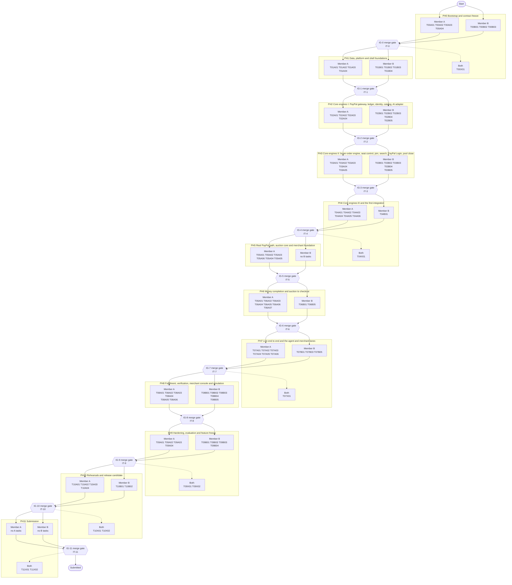

# Team split

Two members, two lanes, twelve merge gates. Phase 0 through 3 task IDs and ownership remain as recorded. From Phase 4 onward, Member A leads the payment, beacon, allocation, auction, merchant and agent API engines; Member B leads intake, search, UI, MCP, simulation and independent tests. No tasks or dependencies are waived.

| | Member A | Member B |
|---|---|---|
| Main responsibility from PH4 | Payment and core engines, beacon, allocation, merchant/bid/auction, reconciliation and agent APIs | Intake, search, UI, MCP, simulation, evaluation and independent property/concurrency checks |
| Coordination | Merge the Phase 7 agent API before its MCP consumer | Rebase the Phase 7 MCP work on that merge and independently review core outcomes |

The Oct 30 solo-operation record is historical: CODEOWNERS currently uses `@shaahir27`. Replace handles only when the second member's GitHub identity is confirmed. Existing Phase 0 through 3 work and its recorded ownership are not rewritten.

## 1. Flow at a glance



The same flow as plain text. Lanes can work in parallel against contracts. In Phase 7, A merges T07A05 before B implements dependent T07B03; both remain required for IG-7.

```
PH0  A: T00A01 T00A02 T00A03 T00A04
     B: T00B01 T00B02 T00B03
     both: T00X01
     ==== IG-0 merge gate, IT-0 ====
PH1  A: T01A01 T01A02 T01A03 T01A04
     B: T01B01 T01B02 T01B03 T01B04
     ==== IG-1 merge gate, IT-1 ====
PH2  A: T02A01 T02A02 T02A03 T02A04
     B: T02B01 T02B02 T02B03 T02B04 T02B05
     ==== IG-2 merge gate, IT-2 ====
PH3  A: T03A01 T03A02 T03A03 T03A04 T03A05
     B: T03B01 T03B02 T03B03 T03B04 T03B05
     ==== IG-3 merge gate, IT-3 ====
PH4  A: T04A01 T04A02 T04A03 T04A04 T04A05 T04A06
     B: T04B01
     both: T04X01
     ==== IG-4 merge gate, IT-4 ====
PH5  A: T05A01 T05A02 T05A03 T05A06 T05A04 T05A05
     B: none
     ==== IG-5 merge gate, IT-5 ====
PH6  A: T06A01 T06A02 T06A03 T06A04 T06A05 T06A06 T06A07
     B: T06B01 T06B05
     ==== IG-6 merge gate, IT-6 ====
PH7  A: T07A01 T07A02 T07A03 T07A04 T07A05 T07A06
     B: T07B01 T07B03 T07B05
     both: T07X01
     ==== IG-7 merge gate, IT-7 ====
PH8  A: T08A01 T08A02 T08A03 T08A04 T08A05 T08A06
     B: T08B01 T08B02 T08B03 T08B04 T08B05
     ==== IG-8 merge gate, IT-8 ====
PH9  A: T09A01 T09A02 T09A03 T09A04
     B: T09B01 T09B02 T09B03 T09B04
     both: T09X01 T09X02
     ==== IG-9 merge gate, IT-9 ====
PH10 A: T10A01 T10A02 T10A03 T10A04
     B: T10B01 T10B02
     both: T10X01 T10X02
     ==== IG-10 merge gate, IT-10 ====
PH11 A: none
     B: none
     both: T11X01 T11X02
     ==== IG-11 merge gate, IT-11 ====
```

## 2. Ownership map

Through Phase 3, the existing paths and task ownership remain unchanged. From Phase 4 onward, the following approved overrides take precedence: Member A owns `backend/src/fairpool/adapters/beacon/**`, `modules/{allocation,merchants,agentapi}/**`, `modules/auction/**` except quote parsing, the merchant, merchant-key and agent routers, and `api/merchant_api/**`; Member B owns quote parsing, search, intake, MCP, simulation, buyer/merchant/audit interfaces and independent property/concurrency tests. Checkout and ops interfaces remain A-owned. The task owner coordinates changes in shared pool and public API files. The planned `flags.py` reconciliation task is A-owned. The actual CODEOWNERS handles remain pending confirmation.

Each path has exactly one owner subject to those phase-based overrides. Anything not listed is created only by a task that names it. Changes to files owned by the other member go through a request in `docs/progress.md` (Requests) or a contract change request. CODEOWNERS in `docs/scaffold.md` section 8 mirrors this table.

| Path | Owner |
|---|---|
| `backend/src/fairpool/infra/**`, `db/**`, `main.py`, `worker.py`, `logging.py`, `api/app.py`, `api/errors.py` | A |
| `backend/src/fairpool/adapters/paypal/**` | A |
| `backend/src/fairpool/modules/{checkout,ledger,webhooks,reconciler,fulfillment}/**` | A |
| `backend/src/fairpool/api/routers/{checkout,webhooks,admin_ops,health,merchant_fulfillment}.py`, `api/merchant_api/routes_fulfillment.py` | A |
| `backend/tests/{contract_sandbox,faults}/**` | A |
| `frontend/src/{checkout,merchant-fulfillment,ops}/**` | A |
| `deploy/**`, `.github/**`, `tools/**` (except `tools/export_merchant_openapi.py`), `Makefile`, `sdk/**` | A |
| `backend/src/fairpool/domain/**` | B |
| `backend/src/fairpool/adapters/{ai,beacon,search}/**` | B |
| `backend/src/fairpool/modules/{identity,catalog,intake,pools,allocation,auction,merchants,search,agentapi,mcp,sim,notify}/**` | B |
| `backend/src/fairpool/api/routers/{auth,paypal_login,pools,intake,entries,public,merchant,merchant_keys,agent,admin_pools,admin_sim}.py`, `api/{schemas,deps}.py`, `api/merchant_api/{app,routes_lots_bids}.py`, `tools/export_merchant_openapi.py` | B |
| `backend/src/fairpool/fakes/**` (fakes for ledger, jobs, audit, idempotency, clock and payments are written by A, the rest by B; both appear in one folder) | B for the folder, A for its own files |
| `backend/tests/{property,concurrency,ai_eval}/**` | B |
| `frontend/src/{shared,buyer,merchant,audit}/**`, frontend build config | B |
| `backend/tests/{unit,integration}/**` | the owner of the code under test |
| Shared, both approve: `docs/contracts/**`, `docs/decisions.md`, `backend/migrations/**`, `backend/src/fairpool/{config,ports,wiring}.py`, `README.md` | both |
| `docs/progress.md` | each member edits only their own rows and entries |

## 3. First 48 hours (PH0), in order

1. **Both, about 2 hours, day 1 morning.** Read `docs/00-index.md`, `AGENTS.md` and every file in `docs/contracts/`. Write any question as an open question in `docs/progress.md`.
2. **Member A: T00A01.** Bootstrap the repository and merge it first (Member B reviews within the hour). Everyone branches from it.
3. **Member A: T00A02 now** (it needs the owner's hands in the PayPal dashboard); then T00A03 and T00A04.
4. **Member B: T00B02 and T00B03 now** (spikes S1 and S7 need no repository); then T00B01 as soon as T00A01 is merged.
5. **Both, end of day 2, about 2 hours: T00X01.** Close every open question or turn it into a change request, tag `contracts-v1`, run the IT-0 checklist, pass gate IG-0.
6. **Start of PH1:** Member A takes T01A01 (migration 0001) first because other work depends on the schema; Member B takes T01B01, T01B02 and T01B03.

## 4. Phase-by-phase lanes

Each row lists the tasks in the lane (size in brackets). Details are in `docs/implementation-plan.md`.

### PH0: Bootstrap and contract freeze

| Member A lane | Member B lane | Both |
|---|---|---|
| T00A01 (S) Repository bootstrap<br/>T00A02 (S) Secrets hygiene<br/>T00A03 (S) API and worker skeleton, settings, host guard<br/>T00A04 (S) Containers, CI and repo tools | T00B01 (L) Pure domain library with shared vectors<br/>T00B02 (S) Spike S1 Log in with PayPal<br/>T00B03 (S) Spike S7 payee-email routing | T00X01 (M) Contract review and freeze |

Merge gate IG-0; test IT-0. Load: Member A 1.25 of 2 days, Member B 1.75 of 2 days.

### PH1: Data, platform and shell foundations

| Member A lane | Member B lane | Both |
|---|---|---|
| T01A01 (L) Database foundation and migration 0001<br/>T01A02 (M) Platform services<br/>T01A03 (S) Deploy the skeleton to Render<br/>T01A04 (S) Spike S2 follow-up | T01B01 (M) API schemas, route-table test and Merchant API OpenAPI<br/>T01B02 (M) Port fakes and award fixture<br/>T01B03 (M) Frontend scaffold<br/>T01B04 (S) Spike S6 beacon and sandbox buyers | none |

Merge gate IG-1; test IT-1. Load: Member A 2.00 of 2 days, Member B 1.75 of 2 days.

### PH2: Core engines I: PayPal gateway, ledger, identity, catalog, AI adapter

| Member A lane | Member B lane | Both |
|---|---|---|
| T02A01 (L) PayPal gateway (raw REST)<br/>T02A02 (M) Payment routers and fake gateway<br/>T02A03 (S) Ledger service<br/>T02A04 (S) Spike S4 payload ladder | T02B01 (M) Identity and notifier<br/>T02B02 (M) Catalog, pool templates, admin publish and rules<br/>T02B03 (M) AI adapter and run logging<br/>T02B04 (S) Spike S8 Elastic hybrid search<br/>T02B05 (S) Spike S13 JavaScript SDK v6 | none |

Merge gate IG-2; test IT-2. Load: Member A 2.00 of 2 days, Member B 2.00 of 2 days.

### PH3: Core engines II: buyer-order engine, seat control, join, search, PayPal Login, pool close

| Member A lane | Member B lane | Both |
|---|---|---|
| T03A01 (L) Buyer-order transition engine<br/>T03A02 (M) Offer expiry and seat control<br/>T03A03 (S) Spike S5 webhooks<br/>T03A04 (S) Spike S10 PayPal MCP read-only verification<br/>T03A05 (S) Spike S12 shipment tracking | T03B01 (M) Pool join, receipts and events<br/>T03B02 (M) Search service and indexer<br/>T03B03 (M) PayPal Login link flow<br/>T03B04 (S) Pool close<br/>T03B05 (S) Spike S11 APIMatic generation | none |

Merge gate IG-3; test IT-3. Load: Member A 2.25 of 2 days, Member B 2.00 of 2 days.

### PH4: Core engines III and the first integration

| Member A lane | Member B lane | Both |
|---|---|---|
| T04A01 (M) lot.open_checkout handler<br/>T04A02 (L) Approval checks and authorization flow (fake router)<br/>T04A03 (L) Funding trigger and capture sweep (fake router)<br/>T04A04 (M) Beacon adapter and pool.seed<br/>T04A05 (L) Allocation and AllocationReadService<br/>T04A06 (S) Public audit endpoint and keys | T04B01 (L) Intake pipeline | T04X01 (L) First integration: pool to checkout |

Merge gate IG-4; test IT-4. Load: Member A 4.75 of 2 days, Member B 1.50 of 2 days.

### PH5: Real PayPal path, auction core and merchant foundation

| Member A lane | Member B lane | Both |
|---|---|---|
| T05A01 (L) Real PayPal path for one buyer (redirect)<br/>T05A02 (L) Checkout UI<br/>T05A03 (M) Failure path and compensating refund (fake router)<br/>T05A06 (M) Merchant profile and onboarding states<br/>T05A04 (L) Bid API with receipts and sealing<br/>T05A05 (L) Auction rules engine | none | none |

Merge gate IG-5; test IT-5. Load: Member A 5.00 of 2 days, Member B 0.00 of 2 days.

### PH6: Money completion and auction to checkout

| Member A lane | Member B lane | Both |
|---|---|---|
| T06A01 (L) Funding sweep and failure path on the real Sandbox<br/>T06A02 (M) Webhooks<br/>T06A03 (L) Reconciler and unknown-outcome resolution<br/>T06A04 (M) Payload ladder levels and shipping address<br/>T06A05 (M) AI offer reconciliation and flags<br/>T06A06 (L) Lot handlers: bid_open, bid_close, award<br/>T06A07 (M) Merchant API keys and MerchantAuth | T06B01 (M) Quote parsing and confirmation<br/>T06B05 (L) Buyer UI v1: Discover and Join | none |

Merge gate IG-6; test IT-6. Load: Member A 5.00 of 2 days, Member B 1.50 of 2 days.

### PH7: Live end to end and the agent and merchant lanes

| Member A lane | Member B lane | Both |
|---|---|---|
| T07A01 (L) JavaScript SDK v6 approval<br/>T07A02 (M) Refill orchestration<br/>T07A03 (S) Routers per S3 and S7<br/>T07A04 (L) Ops console v1<br/>T07A05 (L) Agent API and delegations<br/>T07A06 (M) Merchant Agent API sub-app: lots and bids | T07B01 (L) Buyer UI v2: My Pools and Orders<br/>T07B03 (M) FairPool MCP server<br/>T07B05 (M) Search in the merchant lane and advisory similarity | T07X01 (L) Live end-to-end integration |

Merge gate IG-7; test IT-7. Load: Member A 4.75 of 2 days, Member B 2.50 of 2 days.

### PH8: Fulfillment, verification, merchant console and simulation

| Member A lane | Member B lane | Both |
|---|---|---|
| T08A01 (L) Fulfillment backend: progress, fulfillment, shipments, manifest, verification<br/>T08A02 (M) Fulfillment tab UI<br/>T08A03 (M) Merchant Agent API: fulfillment, shipments, manifest and verification routes<br/>T08A04 (M) PayPal MCP verification copilot<br/>T08A05 (M) Observability<br/>T08A06 (M) Security pass | T08B01 (L) Merchant console UI I: Demand Board and bid submission<br/>T08B02 (L) Merchant console UI II: Active Bids and Developer API<br/>T08B03 (S) Spike S9 Zapier MCP managed mode<br/>T08B04 (L) Simulation engine<br/>T08B05 (S) Zapier bridge setup and documentation | none |

Merge gate IG-8; test IT-8. Load: Member A 3.50 of 2 days, Member B 3.50 of 2 days.

### PH9: Hardening, evaluation and feature freeze

| Member A lane | Member B lane | Both |
|---|---|---|
| T09A01 (L) Fault-injection suite<br/>T09A02 (M) Sandbox contract suite complete<br/>T09A03 (M) Deployment hardening and demo tooling<br/>T09A04 (S) STRETCH: top-up after FUNDED | T09B01 (L) Public audit page and verify-my-place<br/>T09B02 (L) AI evaluation sets and runner<br/>T09B03 (M) Concurrency and property suites for pools, allocation and auction<br/>T09B04 (M) UI polish and honesty copy | T09X01 (L) README full draft<br/>T09X02 (M) Feature freeze and IT-3 |

Merge gate IG-9; test IT-9. Load: Member A 3.00 of 1 days, Member B 3.75 of 1 days.

### PH10: Rehearsals and release candidate

| Member A lane | Member B lane | Both |
|---|---|---|
| T10A01 (M) Fixes from rehearsal 1 (payments, ops, fulfillment)<br/>T10A02 (M) Repository cleanup and compliance<br/>T10A03 (M) Devpost text<br/>T10A04 (M) Merchant SDKs and developer portal | T10B01 (M) Fixes from rehearsal 1 (product, UI, agent lane)<br/>T10B02 (L) Demo video | T10X01 (M) Rehearsal 1<br/>T10X02 (M) Rehearsal 2 clean run |

Merge gate IG-10; test IT-10. Load: Member A 2.50 of 2 days, Member B 2.00 of 2 days.

### PH11: Submission

| Member A lane | Member B lane | Both |
|---|---|---|
| none | none | T11X01 (M) Final checks and submit<br/>T11X02 (S) Post-submit verification |

Merge gate IG-11; test IT-11. Load: Member A 0.38 of 1 days, Member B 0.38 of 1 days.

## 5. Merge points

| Gate | Who runs `make gate-check` | Tag |
|---|---|---|
| IG-0 | Member A (the other member reviews the result) | `ig-0` |
| IG-1 | Member B (the other member reviews the result) | `ig-1` |
| IG-2 | Member A (the other member reviews the result) | `ig-2` |
| IG-3 | Member B (the other member reviews the result) | `ig-3` |
| IG-4 | Member A (the other member reviews the result) | `ig-4` |
| IG-5 | Member B (the other member reviews the result) | `ig-5` |
| IG-6 | Member A (the other member reviews the result) | `ig-6` |
| IG-7 | Member B (the other member reviews the result) | `ig-7` |
| IG-8 | Member A (the other member reviews the result) | `ig-8` |
| IG-9 | Member B (the other member reviews the result) | `ig-9` |
| IG-10 | Member A (the other member reviews the result) | `ig-10` |
| IG-11 | Member B (the other member reviews the result) | `ig-11` |

## 6. Daily flow

1. **Daily sync, 15 minutes**, at a fixed time both members choose on day 1 (record it in `docs/progress.md`). Agenda: yesterday's merges, today's tasks, blockers, anything needing the owner.
2. **Task loop.** Pick a task whose dependencies are merged and whose phase is current (or a pull-forward task, section 11). Set it `IN PROGRESS` in `docs/progress.md`. Branch `a/<TASK-ID>-slug` or `b/<TASK-ID>-slug` from up-to-date `main`. Write tests alongside code. `make verify` before every pull request.
3. **Pull request.** Title `<TASK-ID>: summary`; use the template; at most about 400 changed lines (split work otherwise). The other member reviews within 12 hours; the author squash-merges after approval and a green CI; mark the task `DONE` with the PR number.
4. **Rebase `main` at least once a day.** `main` is always green; if CI on `main` goes red, fixing it is everyone's first task.
5. **Next-phase work.** Branches for the next phase may be opened early, but their pull requests merge only after the current gate passes.
6. **Never** edit files you do not own, edit a contract without a change request, force-push `main`, or merge your own pull request without the other member's approval.

## 7. Gate procedure

1. Two hours before the gate time, stop opening new pull requests for the phase and finish reviews.
2. Both lanes merged: `make gate-check GATE=ig-<n>`, then run the IT-n checklist in `docs/testing-strategy.md` by hand where it says so.
3. If it passes: push tag `ig-<n>`, update `docs/progress.md` (gate row and velocity log), and hold a 10-minute retro: what slipped, what the next phase needs from the other lane.
4. If it fails: the member who owns the failing area fixes first; the other member helps by reviewing or taking that member's next unblocked task. The phase is not closed until IT-n passes.
5. **Hotfix rule.** After a gate passes, fixes to merged code of earlier phases are normal pull requests titled `HOTFIX <TASK-ID>: ...` and must add a regression test.

## 8. Contract change requests

Contracts are frozen at `contracts-v1`. A change request (issue template `contract-change`, then a pull request titled `CR: ...` that edits `docs/contracts/**`, adds a change-log row, and lists affected tasks) needs both members' approval. After it merges, tag `contracts-v1.<n>`; each owner updates their code within 24 hours. If a task can proceed without the change, it proceeds against the old contract and is updated later.

## 9. Handoffs between the lanes

| Handoff | From | To | Contract | Fake used until the real thing merges | Real wiring |
|---|---|---|---|---|---|
| HO-1 Platform services (jobs, audit, idempotency, clock) | A (T01A02) | B | `domain-ports.md` section 2 | `FakeJobQueue`, `FakeAuditLog`, `FakeIdempotencyStore`, `FakeClock` | IG-1 |
| HO-2 Ports and fakes | B (T01B02) | A | `domain-ports.md` | none (the ports are the starting point) | IG-1 |
| HO-3 API schemas and route-table test | B (T01B01) | A | `api.md` | none | IG-1 |
| HO-4 Frontend scaffold and generated client | B (T01B03) | A | `scaffold.md` sections 1, 5, 12 | none | IG-1 |
| HO-5 Notifier | B (T02B01) | A | `domain-ports.md` section 3 | `FakeNotifier` | IG-2 |
| HO-6 Fairness vectors and pure domain library | B (T00B01) | A | `fairness-and-hashing.md` | none | IG-0 |
| HO-7 Allocation read service and merchant directory | A (T04A05) | A (internal handoff) | `domain-ports.md` section 4 | `FakeAllocationRead`, `FakeMerchantDirectory` | IG-4 (T04X01) |
| HO-8 Award handoff | A (T06A06) | A (internal handoff) | `domain-ports.md` section 6 | the `force-award` helper | IG-6 |
| HO-9 Offer checkout component | A (T05A02) | B | `scaffold.md` section 5 rule 8 | a stub `OfferCheckout` in B's mock | IG-5, used in T07B01 |
| HO-10 Refill candidates | A (T04A05) | A (internal handoff) | `domain-ports.md` section 4.1 | `FakeAllocationRead.next_candidates` | IG-7 (T07A02) |
| HO-11 Merchant identity (API keys and sessions) | A (T06A07) | A (internal handoff) | `domain-ports.md` section 3 | `FakeMerchantAuth` | IG-8 (T08A01, T08A03) |
| HO-12 Merchant Agent API sub-app | A (T07A06) | A (internal handoff) | `api.md` section 4.3 | none | IG-8 (T08A03) |
| HO-13 Money facts (ledger, order status) read by the UI | A | B | `api.md` orders and progress | recorded API fixtures | IG-7 and IG-8 |

## 10. Conflict avoidance

- One owner per path (section 2). Shared files change rarely and only with both approvals.
- Migration `0001` is the only schema migration until a change request needs another; two members never write migrations in parallel.
- Frontend areas never import each other except through `index.ts` exports (`scaffold.md` section 5 rule 8); the eslint boundary rule enforces it.
- Fakes are the contract in code: if a fake and a port disagree, fix the fake in a pull request that names both owners.
- `docs/progress.md`: each member edits only their own rows to avoid merge conflicts; gate rows are edited by the member who ran the gate.

## 11. Blocked, behind or idle

- **Blocked on the other lane.** Log it in `docs/progress.md` (Blockers), code against the fake, and take another unblocked task or a pull-forward UI task. Never edit the other lane's files to unblock yourself.
- **Behind by more than a day** at any gate: say so at the sync, record it in the velocity log, and the other member offers one swap from the list below.
- **Finished early.** Take the next unblocked task in your lane; if none, take a pull-forward UI task, then offer a swap.
- **Swap candidates** (either member may take these from the other if agreed at the sync and logged): T08A02, T08A05, T08B01, T08B02, T09B04, T09A03. A swap changes only the task owner, not the task's paths; the receiving member works in the other lane's UI or test paths via a pull request that the owner approves.
- **Escalation.** Anything needing the owner (credentials, trials, dashboard actions, decisions) goes in `docs/progress.md` (Requests to the owner) and is raised at the sync.

## 12. Ordered task lists

### Member A

| Order | Task | Size | Phase | Gate | Depends on |
|---|---|---|---|---|---|
| 1 | T00A01 Repository bootstrap | S | PH0 | IG-0 | none |
| 2 | T00A02 Secrets hygiene | S | PH0 | IG-0 | none |
| 3 | T00A03 API and worker skeleton, settings, host guard | S | PH0 | IG-0 | T00A01 |
| 4 | T00A04 Containers, CI and repo tools | S | PH0 | IG-0 | T00A01 |
| 5 | T00X01 Contract review and freeze (both members) | M | PH0 | IG-0 | none |
| 6 | T01A01 Database foundation and migration 0001 | L | PH1 | IG-1 | T00A01 |
| 7 | T01A02 Platform services | M | PH1 | IG-1 | T01A01 |
| 8 | T01A03 Deploy the skeleton to Render | S | PH1 | IG-1 | T00A03, T00A04 |
| 9 | T01A04 Spike S2 follow-up | S | PH1 | IG-1 | T00A02 |
| 10 | T02A01 PayPal gateway (raw REST) | L | PH2 | IG-2 | T00A02, T00A03 |
| 11 | T02A02 Payment routers and fake gateway | M | PH2 | IG-2 | T02A01 |
| 12 | T02A03 Ledger service | S | PH2 | IG-2 | T01A01, T01A02 |
| 13 | T02A04 Spike S4 payload ladder | S | PH2 | IG-2 | T02A01 |
| 14 | T03A01 Buyer-order transition engine | L | PH3 | IG-3 | T02A03, T00B01 |
| 15 | T03A02 Offer expiry and seat control | M | PH3 | IG-3 | T03A01 |
| 16 | T03A03 Spike S5 webhooks | S | PH3 | IG-3 | T01A03 |
| 17 | T03A04 Spike S10 PayPal MCP read-only verification | S | PH3 | IG-3 | none |
| 18 | T03A05 Spike S12 shipment tracking | S | PH3 | IG-3 | none |
| 19 | T04A01 lot.open_checkout handler | M | PH4 | IG-4 | T03A01 |
| 20 | T04A02 Approval checks and authorization flow (fake router) | L | PH4 | IG-4 | T02A02, T03A01 |
| 21 | T04A03 Funding trigger and capture sweep (fake router) | L | PH4 | IG-4 | T02A03, T03A01, T04A02 |
| 22 | T04A04 Beacon adapter and pool.seed | M | PH4 | IG-4 | T03B04, T01B04 |
| 23 | T04A05 Allocation and AllocationReadService | L | PH4 | IG-4 | T04A04 |
| 24 | T04A06 Public audit endpoint and keys | S | PH4 | IG-4 | T03B04, T04A05 |
| 25 | T04X01 First integration: pool to checkout (both members) | L | PH4 | IG-4 | T04A01, T03A02, T04A05 |
| 26 | T05A01 Real PayPal path for one buyer (redirect) | L | PH5 | IG-5 | T04A02, T04X01 |
| 27 | T05A02 Checkout UI | L | PH5 | IG-5 | T01B03 |
| 28 | T05A03 Failure path and compensating refund (fake router) | M | PH5 | IG-5 | T04A03, T02A03 |
| 29 | T05A06 Merchant profile and onboarding states | M | PH5 | IG-5 | T02B01 |
| 30 | T05A04 Bid API with receipts and sealing | L | PH5 | IG-5 | T05A06, T04A05 |
| 31 | T05A05 Auction rules engine | L | PH5 | IG-5 | T00B01, T04A05 |
| 32 | T06A01 Funding sweep and failure path on the real Sandbox | L | PH6 | IG-6 | T05A01, T04A03, T05A03 |
| 33 | T06A02 Webhooks | M | PH6 | IG-6 | T03A03, T02A01 |
| 34 | T06A03 Reconciler and unknown-outcome resolution | L | PH6 | IG-6 | T05A01, T02A03 |
| 35 | T06A04 Payload ladder levels and shipping address | M | PH6 | IG-6 | T05A01, T02A04 |
| 36 | T06A05 AI offer reconciliation and flags | M | PH6 | IG-6 | T05A04, T05A05 |
| 37 | T06A06 Lot handlers: bid_open, bid_close, award | L | PH6 | IG-6 | T05A05, T04A01 |
| 38 | T06A07 Merchant API keys and MerchantAuth | M | PH6 | IG-6 | T05A06 |
| 39 | T07A01 JavaScript SDK v6 approval | L | PH7 | IG-7 | T05A01, T05A02, T02B05 |
| 40 | T07A02 Refill orchestration | M | PH7 | IG-7 | T03A02, T04A05 |
| 41 | T07A03 Routers per S3 and S7 | S | PH7 | IG-7 | T00B03, T05A01 |
| 42 | T07A04 Ops console v1 | L | PH7 | IG-7 | T06A01, T06A02 |
| 43 | T07A05 Agent API and delegations | L | PH7 | IG-7 | T03B01, T04B01 |
| 44 | T07A06 Merchant Agent API sub-app: lots and bids | M | PH7 | IG-7 | T05A04, T06A07 |
| 45 | T07X01 Live end-to-end integration (both members) | L | PH7 | IG-7 | T06A01, T07A02, T06A06 |
| 46 | T08A01 Fulfillment backend: progress, fulfillment, shipments, manifest, verification | L | PH8 | IG-8 | T06A01, T06A07, T03A05 |
| 47 | T08A02 Fulfillment tab UI | M | PH8 | IG-8 | T01B03 |
| 48 | T08A03 Merchant Agent API: fulfillment, shipments, manifest and verification routes | M | PH8 | IG-8 | T07A06, T08A01 |
| 49 | T08A04 PayPal MCP verification copilot | M | PH8 | IG-8 | T08A01, T03A04 |
| 50 | T08A05 Observability | M | PH8 | IG-8 | T01A03 |
| 51 | T08A06 Security pass | M | PH8 | IG-8 | T06A02, T07A01 |
| 52 | T09A01 Fault-injection suite | L | PH9 | IG-9 | T06A03, T06A02 |
| 53 | T09A02 Sandbox contract suite complete | M | PH9 | IG-9 | T02A01, T05A01 |
| 54 | T09A03 Deployment hardening and demo tooling | M | PH9 | IG-9 | T01A03 |
| 55 | T09A04 STRETCH: top-up after FUNDED | S | PH9 | IG-9 | T06A01 |
| 56 | T09X01 README full draft (both members) | L | PH9 | IG-9 | T09A02, T09B02 |
| 57 | T09X02 Feature freeze and IT-3 (both members) | M | PH9 | IG-9 | T07X01 |
| 58 | T10A01 Fixes from rehearsal 1 (payments, ops, fulfillment) | M | PH10 | IG-10 | T10X01 |
| 59 | T10A02 Repository cleanup and compliance | M | PH10 | IG-10 | T09A03 |
| 60 | T10A03 Devpost text | M | PH10 | IG-10 | T09X01 |
| 61 | T10A04 Merchant SDKs and developer portal | M | PH10 | IG-10 | T08A03 |
| 62 | T10X01 Rehearsal 1 (both members) | M | PH10 | IG-10 | T09X01, T09X02 |
| 63 | T10X02 Rehearsal 2 clean run (both members) | M | PH10 | IG-10 | T10A01, T10B01 |
| 64 | T11X01 Final checks and submit (both members) | M | PH11 | IG-11 | T10X02, T10A02, T10A03, T10A04, T10B02 |
| 65 | T11X02 Post-submit verification (both members) | S | PH11 | IG-11 | T11X01 |

### Member B

| Order | Task | Size | Phase | Gate | Depends on |
|---|---|---|---|---|---|
| 1 | T00B01 Pure domain library with shared vectors | L | PH0 | IG-0 | T00A01 |
| 2 | T00B02 Spike S1 Log in with PayPal | S | PH0 | IG-0 | none |
| 3 | T00B03 Spike S7 payee-email routing | S | PH0 | IG-0 | none |
| 4 | T00X01 Contract review and freeze (both members) | M | PH0 | IG-0 | none |
| 5 | T01B01 API schemas, route-table test and Merchant API OpenAPI | M | PH1 | IG-1 | T00B01 |
| 6 | T01B02 Port fakes and award fixture | M | PH1 | IG-1 | T00A01, T00B01 |
| 7 | T01B03 Frontend scaffold | M | PH1 | IG-1 | T00A01 |
| 8 | T01B04 Spike S6 beacon and sandbox buyers | S | PH1 | IG-1 | none |
| 9 | T02B01 Identity and notifier | M | PH2 | IG-2 | T01A01, T01A02, T00B01, T01B02 |
| 10 | T02B02 Catalog, pool templates, admin publish and rules | M | PH2 | IG-2 | T02B01 |
| 11 | T02B03 AI adapter and run logging | M | PH2 | IG-2 | T01B02 |
| 12 | T02B04 Spike S8 Elastic hybrid search | S | PH2 | IG-2 | none |
| 13 | T02B05 Spike S13 JavaScript SDK v6 | S | PH2 | IG-2 | T01A03 |
| 14 | T03B01 Pool join, receipts and events | M | PH3 | IG-3 | T02B01, T02B02, T00B01 |
| 15 | T03B02 Search service and indexer | M | PH3 | IG-3 | T02B02, T02B04 |
| 16 | T03B03 PayPal Login link flow | M | PH3 | IG-3 | T02B01, T00B02 |
| 17 | T03B04 Pool close | S | PH3 | IG-3 | T03B01 |
| 18 | T03B05 Spike S11 APIMatic generation | S | PH3 | IG-3 | T01B01 |
| 19 | T04B01 Intake pipeline | L | PH4 | IG-4 | T02B02, T02B03, T03B02 |
| 20 | T04X01 First integration: pool to checkout (both members) | L | PH4 | IG-4 | T04A01, T03A02, T04A05 |
| 21 | T06B01 Quote parsing and confirmation | M | PH6 | IG-6 | T05A04, T02B03 |
| 22 | T06B05 Buyer UI v1: Discover and Join | L | PH6 | IG-6 | T01B03, T01B01 |
| 23 | T07B01 Buyer UI v2: My Pools and Orders | L | PH7 | IG-7 | T06B05 |
| 24 | T07B03 FairPool MCP server | M | PH7 | IG-7 | T07A05 |
| 25 | T07B05 Search in the merchant lane and advisory similarity | M | PH7 | IG-7 | T03B02, T05A04 |
| 26 | T07X01 Live end-to-end integration (both members) | L | PH7 | IG-7 | T06A01, T07A02, T06A06 |
| 27 | T08B01 Merchant console UI I: Demand Board and bid submission | L | PH8 | IG-8 | T01B03, T01B01 |
| 28 | T08B02 Merchant console UI II: Active Bids and Developer API | L | PH8 | IG-8 | T08B01 |
| 29 | T08B03 Spike S9 Zapier MCP managed mode | S | PH8 | IG-8 | T07A05 |
| 30 | T08B04 Simulation engine | L | PH8 | IG-8 | T04A05, T02A02 |
| 31 | T08B05 Zapier bridge setup and documentation | S | PH8 | IG-8 | T08B03 |
| 32 | T09B01 Public audit page and verify-my-place | L | PH9 | IG-9 | T00B01, T01B01 |
| 33 | T09B02 AI evaluation sets and runner | L | PH9 | IG-9 | T04B01, T06B01, T06A05 |
| 34 | T09B03 Concurrency and property suites for pools, allocation and auction | M | PH9 | IG-9 | T06A06, T03B01 |
| 35 | T09B04 UI polish and honesty copy | M | PH9 | IG-9 | T07B01, T08B01, T08B02 |
| 36 | T09X01 README full draft (both members) | L | PH9 | IG-9 | T09A02, T09B02 |
| 37 | T09X02 Feature freeze and IT-3 (both members) | M | PH9 | IG-9 | T07X01 |
| 38 | T10B01 Fixes from rehearsal 1 (product, UI, agent lane) | M | PH10 | IG-10 | T10X01 |
| 39 | T10B02 Demo video | L | PH10 | IG-10 | T10X02 |
| 40 | T10X01 Rehearsal 1 (both members) | M | PH10 | IG-10 | T09X01, T09X02 |
| 41 | T10X02 Rehearsal 2 clean run (both members) | M | PH10 | IG-10 | T10A01, T10B01 |
| 42 | T11X01 Final checks and submit (both members) | M | PH11 | IG-11 | T10X02, T10A02, T10A03, T10A04, T10B02 |
| 43 | T11X02 Post-submit verification (both members) | S | PH11 | IG-11 | T11X01 |
